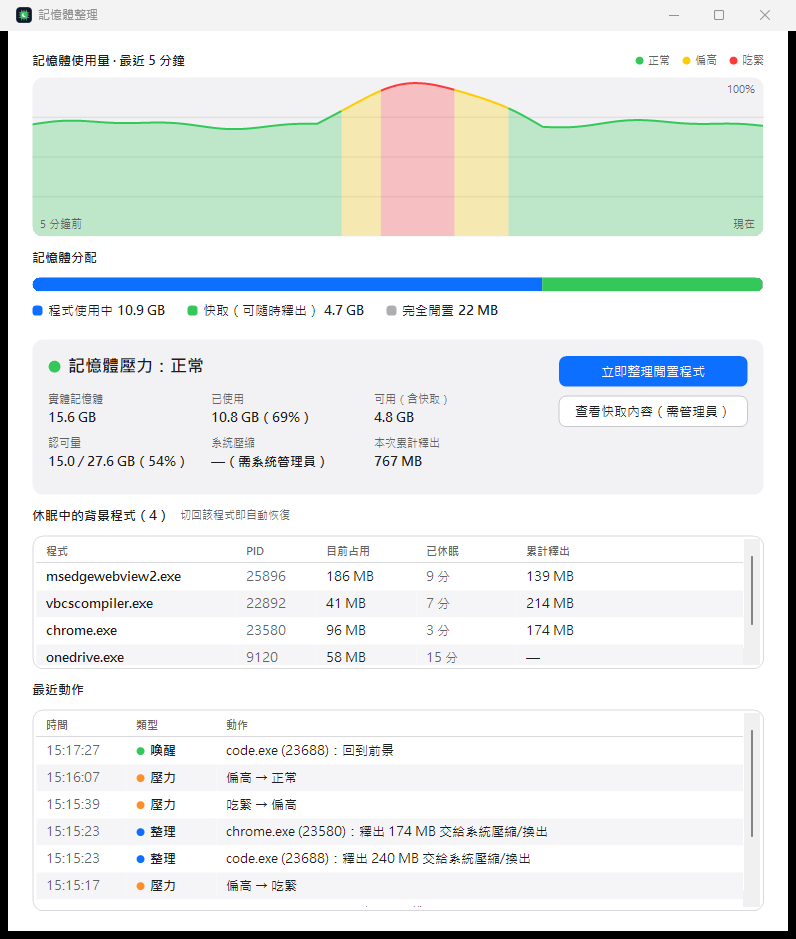
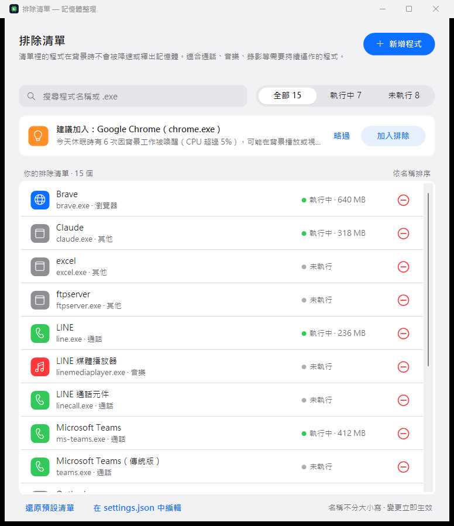
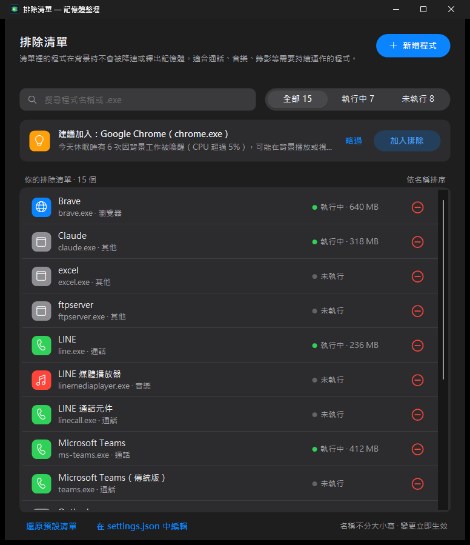
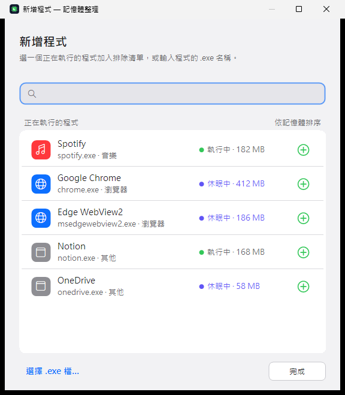
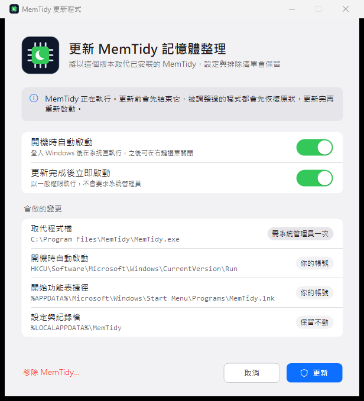
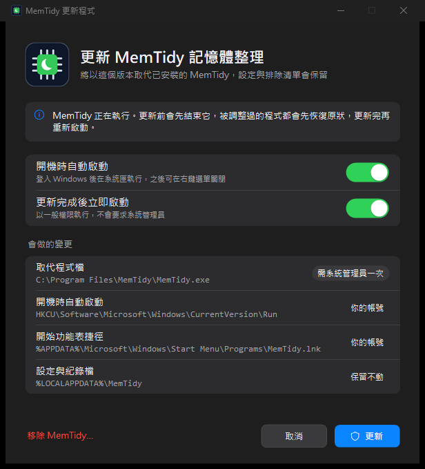
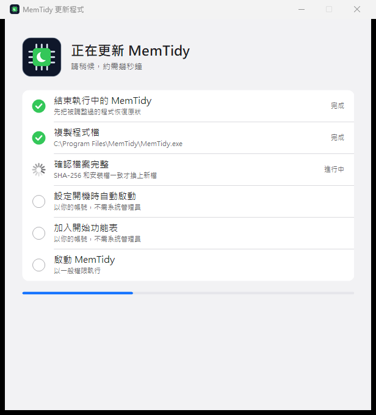

# MemTidy 記憶體整理

仿 macOS 記憶體管理策略的 Windows 系統匣工具。**不關閉任何程式、不清除系統快取**，只在記憶體吃緊時讓「你沒在用的背景程式」讓出資源，你一切回去就立刻恢復。

```
.\build.ps1                 # 產生 dist\MemTidy.exe（需 .NET 10 SDK；執行需 .NET 10 Desktop Runtime）
dist\MemTidy.exe            # 開啟安裝視窗：安裝或更新到 C:\Program Files\MemTidy（Windows 會確認一次），也可從這裡移除
```

命令列版本（行為與安裝視窗相同）：

```
.\install.ps1                              # 安裝或更新、設定開機啟動與開始功能表捷徑，並啟動
.\install.ps1 -Uninstall                   # 移除（設定與紀錄檔保留在 %LOCALAPPDATA%\MemTidy）
.\install.ps1 -Uninstall -RemoveSettings   # 移除，並刪除設定與紀錄檔（包括排除清單）
```

不在 Program Files 的 MemTidy.exe（例如 `dist\`）直接開啟時是安裝視窗；要不安裝直接常駐，用 `MemTidy.exe --tray`（`build.ps1` 重新啟動 `dist\` 版時會這樣做）。`MemTidy.exe --install` 也會開啟安裝視窗。

**為什麼要安裝到 Program Files**：只有系統管理員能修改那裡的檔案。MemTidy 唯一以系統管理員執行的部分是「查看快取內容」視窗，裝在 Program Files 後，你帳號下的其他程式就無法掉包它、也無法在它旁邊放冒名的檔案。MemTidy 本身仍以一般權限執行。更新時先 `.\build.ps1`，再雙擊 `dist\MemTidy.exe`（或執行 `.\install.ps1`）。兩者都只在複製檔案那一步要求系統管理員權限，並確認裝進去的檔案和剛建置的一模一樣；`install.ps1` 加上 `-WhatIf` 可以先看它會做什麼。

## 畫面

**主面板**：最近 5 分鐘的記憶體使用量（顏色＝壓力）、記憶體分配、目前狀態，以及休眠中的程式與最近動作。

<p>
  
  
</p>

預設跟隨 Windows 的淺色／深色模式，也可以在右鍵選單「外觀」固定為淺色或深色（左：淺色，右：深色）。

**排除清單**：在背景也要保持全速的程式（通話、音樂、錄影）。可以搜尋、依「執行中／未執行」篩選、一鍵移除；今天常因背景工作被喚醒的程式會出現在「建議加入」。

<p>
  
  
</p>

**新增程式**：從正在執行的程式挑選（休眠中的會標出來）、輸入 `.exe` 名稱，或選擇 exe 檔。



**快取內容**：哪些檔案正在快取裡，由大到小（需系統管理員）。


**安裝程式**：雙擊 `dist\MemTidy.exe` 開啟。先列出會做的變更、哪一步需要系統管理員，再請 Windows 確認一次；更新時會先結束執行中的 MemTidy（被調整過的程式都會先恢復原狀）。已安裝時左下角可以移除，並選擇要不要一併刪除設定與排除清單。

<p>
  
  
</p>

安裝過程逐步顯示進度；任何一步失敗都會說明原因，而且電腦不會被改動。



**系統匣選單**：圖示顏色就是目前的記憶體壓力（綠／黃／紅，暫停時為灰）。


> 截圖以 `--demo` 模式拍攝：清單內容是固定的範例資料，記憶體數字為實際值。

## 運作方式（對照 macOS）

| macOS | MemTidy 在 Windows 上的做法 |
|---|---|
| 記憶體壓力 綠/黃/紅 | 依可用實體記憶體、認可量、系統低記憶體訊號判斷，進出門檻分開避免跳燈 |
| App Nap | 閒置背景程式開「效率模式」(EcoQoS) 並降為「低於標準」優先權 |
| Inactive 頁面優先回收 | 把閒置程式的記憶體優先權設為「低」，系統需要空間時先回收它們 |
| Compressor | 紅燈時把閒置程式的工作集交還系統，由 Windows 內建記憶體壓縮接手（每輪最多 5 個、同一程式 10 分鐘一次） |
| 回到 App 立即恢復 | 程式一到前景、或在背景開始做事（CPU > 5%），立刻還原 |
| 記憶體寬裕就別急著回收 | 綠燈持續 3 分鐘且可用 ≥ 30% 時，休眠中的程式先恢復記憶體優先權，讓系統保留它們的資料，切回去不用重新載入；壓力回升會再調低 |

**空閒的記憶體不是浪費**：Windows 會把沒人用的記憶體拿來當快取（最近用過的檔案和程式），有人需要時立刻讓出。面板上方的長條把記憶體分成「程式使用中／快取（可隨時釋出）／完全閒置」，所以 MemTidy 不做「清空快取」這種讓電腦變慢的事。

**查看快取裡有哪些檔案**：面板的「查看快取內容」按鈕會列出占用快取最多的檔案（類似 RAMMap 的 File Summary），雙擊可在檔案總管中顯示。這需要系統管理員權限：按下後會跳出 Windows 確認視窗，只有這個清單視窗以系統管理員執行，關掉就結束，常駐的 MemTidy 仍是一般權限。此功能使用 Windows 未公開的介面（與 RAMMap、Process Hacker 相同），Windows 大改版後可能失效，屆時清單會顯示錯誤訊息，不影響其他功能。

**閒置**＝超過 5 分鐘沒在前景，且至少 60 秒 CPU < 1%。同一支程式的所有程序（例如瀏覽器的分頁程序）視為一體。綠燈時不做任何事。

## 使用

- 程式圖示由 `tools\make-icon.ps1` 產生（`app.ico`）；系統匣圖示則依壓力即時著色。
- **以一般權限執行**，不需要系統管理員；只會處理**你自己帳號的程式**。
- **開機時自動啟動**（使用者層級的啟動項目，不需要系統管理員）：用安裝視窗安裝時由「開機時自動啟動」開關決定，`install.ps1` 則一律開啟；未安裝、以 `--tray` 執行時，第一次執行會自動開啟。不要的話在右鍵選單取消勾選即可，之後不會再自動打開。安裝後一律從 `C:\Program Files\MemTidy` 啟動；執行其他位置的 MemTidy（例如 `dist\`）不會改掉它。未安裝時，搬移 exe 位置後以 `--tray` 執行一次，啟動路徑會自動更新。
- **開始功能表**：安裝時會在你帳號的開始功能表加入「MemTidy」捷徑，移除時一併刪除。
- 從舊版（以系統管理員常駐）更新時，會自動移除舊的「工作排程器」工作 `MemTidy`；若 Windows 要求系統管理員權限，會先說明原因再詢問一次。
- 介面依 `MemTidy UI` 設計稿（macOS 26 風格）繪製，預設跟隨 Windows 的淺色／深色應用程式模式（含深色標題列）；右鍵選單「外觀」可改為固定淺色或深色，立即生效並記在設定檔（`"Theme": "system" | "light" | "dark"`）。
- 系統匣圖示顏色＝目前壓力（灰色＝已暫停）；左鍵開面板，右鍵選單可「立即整理」、開啟排除清單、暫停、切換開機啟動、選擇外觀。
- **排除清單**（不會被休眠或整理的程式）：背景要持續運作的程式（通話、音樂、錄影）請加入這裡；預設已包含 Teams、Zoom、Discord、LINE、Spotify 等。從面板的「排除清單…」按鈕或右鍵選單開啟，變更立即生效，剛加入的程式若正在休眠會馬上喚醒；在面板的「休眠中的背景程式」上按右鍵也能直接加入。「建議加入」按「略過」後就不會再建議同一個程式；「還原預設清單」會先確認。系統、安全軟體、輸入法等程式另有內建保護，不在清單上也不會被休眠，也不會出現在「新增程式」裡。
- 設定檔：`%LOCALAPPDATA%\MemTidy\settings.json`（閒置分鐘、CPU 門檻、排除清單等），除排除清單外改完需重開程式生效（排除清單在其視窗重新取得焦點時就會重新讀入）。可以加註解；不合理的值會改用預設並記在紀錄檔，格式錯誤時本次改用預設、不會覆蓋原檔。
- 要從指令或腳本關掉常駐中的 MemTidy（會先還原所有程式）：`MemTidy.exe --exit`；`build.ps1` 也會自動這樣做。
- 紀錄檔：`%LOCALAPPDATA%\MemTidy\memtidy.log`。

結束程式、暫停、登出時會把所有改過的設定還原。若 MemTidy 被強制終止，被調整的程式會維持「低於標準」優先權直到它重新啟動。

## 安全性

- **一般權限常駐**：MemTidy 平常不具系統管理員權限。只有「查看快取內容」會另開一個系統管理員視窗，每次都要你在 Windows 確認視窗同意，關掉就結束。
- **安裝時只有一步用到系統管理員**：安裝視窗不會以系統管理員重新啟動自己（`dist\` 在你可寫的位置，同意之後可能已被換掉），而是把「複製或刪除程式檔」這段固定的程式碼（`AdminStep.ps1`，建置時嵌入）直接交給 System32 的 `powershell.exe`；檔案先複製成 `MemTidy.exe.new`，SHA-256 和安裝檔一致才換上。開機啟動、開始功能表捷徑和啟動 MemTidy 都以你的帳號執行，而且只在這一步成功後才做，所以失敗時電腦不會被改動。公司的資安軟體（例如 Trend Micro Apex One）可能會攔下「MemTidy.exe 啟動 PowerShell」這一步；被攔下時安裝視窗會顯示失敗、不做任何變更，可改用 `install.ps1`。
- **只有安裝版會以系統管理員執行**：安裝到 Program Files 後，要求系統管理員權限的一律是 `C:\Program Files\MemTidy\MemTidy.exe`（只有系統管理員能修改），即使目前執行的是 `dist\` 的版本也一樣。
- **環境變數檢查**：要求系統管理員權限之前，會先檢查你的使用者環境變數有沒有設定會讓 .NET 程式載入額外程式碼的項目（例如 `CORECLR_PROFILER`、`DOTNET_ROOT`）；有的話就不開啟並說明原因。這類變數任何以你身分執行的程式都能設定，是 Program Files 也擋不住的途徑。
- **不碰重要軟體**：防毒與資安代理程式（Windows SmartScreen、Trend Micro 等）、憑證簽章元件（HiPKI、醫事憑證 ServiSign 等）、音訊、輸入法與協助工具一律不調整；除了程式名稱，也會比對發行者與安裝資料夾，改名過的元件也認得出來。
- **權限用完即關**：讀取快取內容時只開啟需要的權限，查詢結束立即關閉。
- **不被冒名**：呼叫的系統工具（schtasks、explorer）與系統 DLL 一律用 System32 的完整路徑載入，放在 MemTidy 旁邊的同名檔案不會被執行；也關閉了 .NET 的啟動掛勾（startup hooks）。
- **以系統管理員身分手動執行時**（不建議）：本次不寫入紀錄檔與設定檔，避免在你的使用者資料夾裡以管理員權限寫檔。
- **不連網**：不傳送任何資料，沒有遙測。
- **建置時**：`build.ps1` 第一次建置（或更新 .NET SDK 後）會由 `dotnet` 從 nuget.org 下載 .NET 執行階段套件；建置期間會關閉 .NET CLI 的遙測與 workload 更新檢查，結束後還原你原本的設定。
- **安全軟體可能會注意到它**：MemTidy 會調整其他程式的優先權與記憶體，快取清單也用到 Windows 未公開的介面（RAMMap 用的同一組）。在公司或機關電腦上使用、或分享給同事前，建議先告知資訊單位。

## 測試參數

```
MemTidy.exe --force-pressure=red --idle-minutes=0.25 --run-seconds=75
MemTidy.exe --force-pressure=yellow --force-for=40 --idle-minutes=0.25 --show-panel
```
第一行：模擬紅燈、閒置門檻 15 秒、75 秒後正常結束（會執行還原）。
第二行：模擬黃燈 40 秒後回到實際狀態，用來測試綠燈恢復記憶體優先權（測試時等待時間會跟著縮短為 15 秒），並一開始就打開面板。

介面測試：`--theme=dark|light` 強制淺色或深色、`--snapshot=面板.png [--snapshot-after=秒]` 與 `--snapshot-cache=快取.png`、`--snapshot-menu=選單.png`、`--snapshot-exclusions=排除清單.png [--snapshot-add=新增.png]` 讓程式自己把視窗存成圖片（螢幕鎖定時也能用）；加上 `--demo` 時清單改用範例資料，適合拍 README 截圖。

安裝視窗：`MemTidy.exe --install --demo [--theme=dark|light] [--installer-step=welcome|uac|progress|done|error|confirmRemove|removed] [--installer-fail=cancel|hash|inuse|failed] [--snapshot-installer=安裝.png]`。`--demo` 或 `--installer-fail` 時只模擬流程，不做任何變更；`--installer-fail` 的失敗只發生一次，按「再試一次」會成功。

另外 `MemTidy.exe --cache-report=報告.txt`（需系統管理員）會把快取內容寫成文字檔後結束，並註明用到了哪些權限；`MemTidy.exe --open-cache` 做的事和面板上的「查看快取內容」按鈕一樣（要求以系統管理員開啟快取視窗），用來測試。
