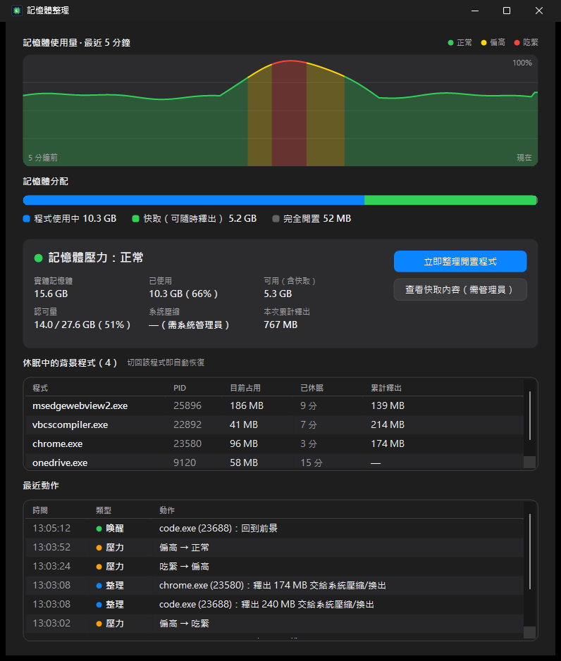
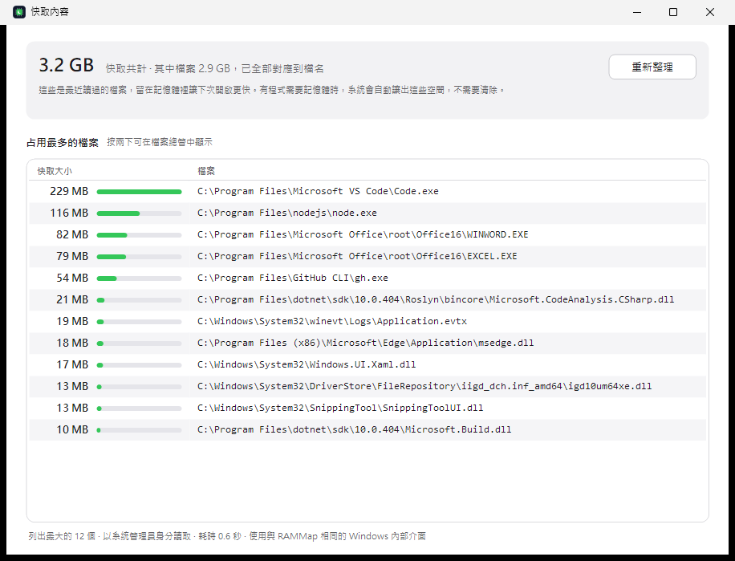
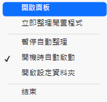

# MemTidy 記憶體整理

仿 macOS 記憶體管理策略的 Windows 系統匣工具。**不關閉任何程式、不清除系統快取**，只在記憶體吃緊時讓「你沒在用的背景程式」讓出資源，你一切回去就立刻恢復。

```
.\build.ps1            # 產生 dist\MemTidy.exe（需 .NET 10 Desktop Runtime）
```

## 畫面

**主面板**：最近 5 分鐘的記憶體使用量（顏色＝壓力）、記憶體分配、目前狀態，以及休眠中的程式與最近動作。

<p>
  
  
</p>

跟隨 Windows 的淺色／深色模式（左：淺色，右：深色）。

**快取內容**：哪些檔案正在快取裡，由大到小（需系統管理員）。



**系統匣選單**：圖示顏色就是目前的記憶體壓力（綠／黃／紅，暫停時為灰）。



> 截圖以 `--demo` 模式拍攝：清單內容是固定的範例資料，記憶體數字為實際值。

## 運作方式（對照 macOS）

| macOS | MemTidy 在 Windows 上的做法 |
|---|---|
| 記憶體壓力 綠/黃/紅 | 依可用實體記憶體、認可量、系統低記憶體訊號判斷，進出門檻分開避免跳燈 |
| App Nap | 閒置背景程式開「效率模式」(EcoQoS) 並降為「低於標準」優先權 |
| Inactive 頁面優先回收 | 把閒置程式的記憶體優先權設為「低」，系統需要空間時先回收它們 |
| Compressor | 紅燈時把閒置程式的工作集交還系統，由 Windows 內建記憶體壓縮接手（每輪最多 5 個、同一程式 10 分鐘一次） |
| 回到 App 立即恢復 | 程式一到前景、或在背景開始做事（CPU > 5%），立刻還原 |
| 記憶體寬裕就別急著回收 | 綠燈持續 3 分鐘且可用 ≥ 30% 時，休眠中的程式先恢復記憶體優先權，讓系統保留它們的資料，切回去不用重新載入；壓力回升會再調低 |

**空閒的記憶體不是浪費**：Windows 會把沒人用的記憶體拿來當快取（最近用過的檔案和程式），有人需要時立刻讓出。面板上方的長條把記憶體分成「程式使用中／快取（可隨時釋出）／完全閒置」，所以 MemTidy 不做「清空快取」這種讓電腦變慢的事。

**查看快取裡有哪些檔案**：面板的「查看快取內容」按鈕會列出占用快取最多的檔案（類似 RAMMap 的 File Summary），雙擊可在檔案總管中顯示。這需要系統管理員權限；MemTidy 預設就是以系統管理員執行，會直接開啟。若當下是一般權限，按下後會跳出確認視窗，只讓清單視窗以系統管理員執行。此功能使用 Windows 未公開的介面（與 RAMMap、Process Hacker 相同），Windows 大改版後可能失效，屆時清單會顯示錯誤訊息，不影響其他功能。

**閒置**＝超過 5 分鐘沒在前景，且至少 60 秒 CPU < 1%。同一支程式的所有程序（例如瀏覽器的分頁程序）視為一體。綠燈時不做任何事。

## 使用

- 程式圖示由 `tools\make-icon.ps1` 產生（`app.ico`）；系統匣圖示則依壓力即時著色。
- **預設以系統管理員執行**：第一次開啟會跳出一次 Windows 確認視窗，之後透過「工作排程器」裡名為 `MemTidy` 的工作（最高權限）在登入時自動啟動，不會再跳確認。之後再手動開啟也會改由這個工作啟動，不必再按確認。若在確認視窗按「否」，就以一般權限執行。
- 即使以系統管理員執行，MemTidy 也只會處理**你自己帳號的程式**，不會動到系統或其他帳號的程序。
- 第一次執行就會自動設定「開機時自動啟動」；不要的話在右鍵選單取消勾選即可（會刪除排程工作），之後不會再自動打開。搬移 exe 位置後執行一次，啟動路徑會自動更新。
- 介面依 `MemTidy UI` 設計稿（macOS 26 風格）繪製，跟隨 Windows 的淺色／深色應用程式模式（含深色標題列）。
- 系統匣圖示顏色＝目前壓力（灰色＝已暫停）；左鍵開面板，右鍵選單可「立即整理」、暫停、切換開機啟動。
- 設定檔：`%LOCALAPPDATA%\MemTidy\settings.json`（閒置分鐘、CPU 門檻、排除清單等），改完重開程式生效。
- 要從指令或腳本關掉常駐中的 MemTidy（會先還原所有程式）：`MemTidy.exe --exit`；`build.ps1` 也會自動這樣做。
- 紀錄檔：`%LOCALAPPDATA%\MemTidy\memtidy.log`。
- 背景要持續運作的程式（通話、音樂、錄影）請加入 `Exclusions`；預設已包含 Teams、Zoom、Discord、LINE、Spotify 等。

結束程式、暫停、登出時會把所有改過的設定還原。若 MemTidy 被強制終止，被調整的程式會維持「低於標準」優先權直到它重新啟動。

## 測試參數

```
MemTidy.exe --force-pressure=red --idle-minutes=0.25 --run-seconds=75
MemTidy.exe --force-pressure=yellow --force-for=40 --idle-minutes=0.25 --show-panel
```
介面測試：`--theme=dark|light` 強制淺色或深色、`--snapshot=面板.png [--snapshot-after=秒]` 與 `--snapshot-cache=快取.png`、`--snapshot-menu=選單.png` 讓程式自己把視窗存成圖片（螢幕鎖定時也能用）；加上 `--demo` 時清單改用範例資料，適合拍 README 截圖。

另外 `MemTidy.exe --cache-report=報告.txt`（需系統管理員）會把快取內容寫成文字檔後結束。
第一行：模擬紅燈、閒置門檻 15 秒、75 秒後正常結束（會執行還原）。
第二行：模擬黃燈 40 秒後回到實際狀態，用來測試綠燈恢復記憶體優先權（測試時等待時間會跟著縮短為 15 秒），並一開始就打開面板。
